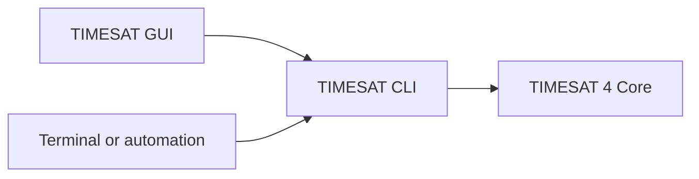

# 2 Software Overview

[Previous: Introduction](01-introduction.md) · [Guide home](../README.md) · [Contents](table-of-contents.md)

**Public Draft (Under Review) · 18 November 2026**

## 2.1 Software components

TIMESAT separates scientific computation, processing orchestration and user
interaction into three components.

| Component | Role | User interaction |
| --- | --- | --- |
| **TIMESAT 4 Core** | Performs numerical time-series processing, fitting and seasonal-metric calculations | Supplies the common scientific calculations used through CLI and GUI workflows |
| **TIMESAT CLI** | Organises processing: reads configuration and raster inputs, prepares observations, calls Core and writes outputs | Provides terminal raster processing and the processing layer used by the GUI |
| **TIMESAT GUI** | Provides desktop tools for loading and inspecting data, configuring fits, viewing results and running raster jobs | Offers plots, raster/pixel tools, settings, result tables, exports and batch controls |

The interfaces share the same scientific processing chain. GUI exploration and
desktop raster processing both use the CLI layer to reach Core. Terminal users
work through the CLI directly.

## 2.2 Processing architecture

*Figure 2.1. Processing follows GUI -> CLI -> Core. Terminal users enter at the
CLI layer.*

In interactive exploration, a user selects a series or pixel, chooses fitting
settings and inspects the resulting curves and metrics. In raster batch
processing, a configuration applies the selected analysis to an image or
subarea and produces raster outputs. The GUI provides desktop controls for
both; the CLI provides the terminal batch workflow.

With the same observations, effective parameters and output conventions,
corresponding scientific results should be consistent across these workflows.
The [reference versions](../README.md#reference-versions) form a verified
compatible combination.

## 2.3 Available workflows

| User task | Workflow and input | Results and scope |
| --- | --- | --- |
| Examine a small collection of dated series | **GUI table exploration:** CSV data with dates in the first column and separate series in the remaining columns | Observations, fitted curves, seasonal-metric tables and selected exports |
| Inspect spatial and temporal variation before a raster run | **GUI raster exploration:** a list of raster images or a temporal GeoTIFF stack | Map/pixel inspection, fit comparison and region-of-interest summaries |
| Process raster data from the desktop | **GUI raster batch:** raster-list or stack inputs, processing settings and an output location | Full-image or subarea analysis with raster outputs |
| Run raster analysis from a terminal or script | **CLI raster batch:** grouped JSON configuration and raster-list or stack inputs | Processing logs and fitted-series/seasonal raster outputs; configuration can define class-specific profiles and processing windows |

Table exploration and raster batch processing serve different tasks. CSV input
is used for interactive exploration; the batch workflows described here take
raster inputs. Table support does not imply a terminal CSV batch command.

A **region of interest (ROI)** selects an area for descriptive summaries of
raw raster observations. The GUI provides a spatial mean and standard deviation
for each observation time. These summaries describe spatial variation in the
observations; they are not fitted regional phenology products or confidence
intervals for a fitted curve.

## 2.4 Fitting methods and output families

The fitting methods described here are **double logistic
fitting (DL)** and **smoothing splines (SP)**. Method and parameter choices must
be appropriate to the observations and the seasonal features being studied.
Detailed parameter selection and supported seasonal definitions are described in
the shared [scientific methods chapter](05-scientific-methods.md).

TIMESAT produces two principal output families:

- **Fitted time series:** values sampled from the fitted trajectory, with
  associated fitted-series quality information in raster processing.
- **Seasonal metrics:** quantities describing seasonal timing, fitted values,
  amplitude, slopes, length and integrals. The seasonal-metric inventory contains
  thirteen named metrics; the layers written depend on the configuration.

Raster workflows write GeoTIFF products under `ST` for fitted series and `VPP`
for seasonal metrics, with corresponding quality files. Interactive GUI results
are shown in plots and tables; selected results can be exported as CSV and
figures can be saved. These exports carry selected information and should be
kept with the original observations and effective configuration.

Read corresponding values using the same date, unit and scaling conventions.
Detailed output formats, quality codes and integral scaling are described in the
[output reference chapter](07-outputs-and-quality.md). This overview does not replace those product-specific
definitions.

## 2.5 Workflow boundaries

Interactive exploration helps assess observations and the effects of settings
before a raster run. To reproduce a preview in batch processing, match the
observations, calibration, band selection, effective quality weights, fitting
method, seasonal parameters and output schedule. Compare matching dates and
metrics in the same units and output conventions. If results differ, check
these inputs and settings before interpreting the difference scientifically.

GUI settings save/load preserves a subset of CLI configuration. Retain the
authoritative configuration separately for an advanced CLI analysis; do not
treat a GUI settings file as a complete project containing every input
selection, class profile and metadata item. GUI raster batch processing requires a
single selected fitting method and an existing output directory.

Check output completeness after processing. A stopped run may leave incomplete
products; cancellation should not be treated as a pause/resume facility.
Continue with [installation](03-installation.md), the detailed execution
procedures and [worked examples](11-worked-examples.md) linked from the
[contents](table-of-contents.md).

---

[Previous: Introduction](01-introduction.md) · [Guide home](../README.md) · [Contents](table-of-contents.md)
