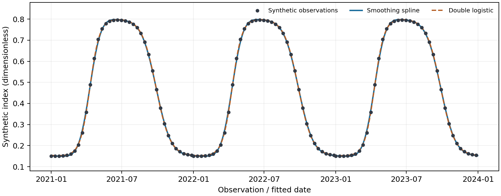

# 11 Worked examples

[Previous](10-raster-processing.md) · [Contents](table-of-contents.md) · [Next](12-troubleshooting.md)

These examples use original synthetic data and the reference Core 4.4.1/CLI 1.9.2 combination. They demonstrate software/data contracts and seasonal fitting, not satellite-product accuracy or biological validation. GUI procedures use the compatible GUI 1.6.2 reference; the numerical GUI check described below exercised its matching source-service implementation, not mouse interaction with every official executable.

## 11.1 Generate and explore the dataset

Run the following from the documentation repository root, the directory containing `examples/` and `user-guide/`, using the pinned terminal environment. Keep generated datasets and outputs outside the repository when preserving a clean documentation checkout; replace `timesat-example` consistently with that chosen destination.

```sh
python examples/generate_example.py timesat-example
```

The destination must be new or empty. The generator refuses to overwrite existing content. To repeat data generation, choose a new directory. It creates:

| File | Meaning |
| --- | --- |
| `series.csv` | Date plus two synthetic seasonal series |
| `vi_stack.tif` | 4×4 float32 temporal raster, 111 observations over 2021–2023 |
| `qa_stack.tif` | Matched binary QA stack with all observations initially valid |
| `qa_gap_stack.tif` | Same dates, excluding observations from day-of-year 140–170 |
| `landcover.tif` | Two synthetic class codes on the same grid |
| `settings.json` | SP raster run sampled every 16 synthetic days |
| `settings_daily.json` | Same input/fit with daily output |
| `settings_monthly.json` | Same input/fit sampled on month days 1, 11 and 21 |
| `settings_multiclass.json` | SP for class 1 and DL for class 2 |
| `settings_qa_gap.json` | The excluded-observation QA experiment |

The CRS/transform are illustrative metadata, not a real study site. Values are a dimensionless synthetic index generated from smooth logistic seasonal transitions. Two column groups have different timing; each has repeated seasons. The generator records complete paths, so regenerate after relocating the dataset rather than assuming old JSON paths remain valid.

For GUI table exploration, select `series.csv` as **Data File**, choose **Load Data**, and inspect both series. Set Data Range to 0–1.2, SP smoothing to 1000, no additional envelope pass, strength 1, Base Level 0.05, irregular season parameter 1, seasonal-amplitude threshold method and start/end cutoffs 0.25/0.15. A broad unit-weight interval can represent this table's unit-quality input. Inspect raw observations and the fitted trajectory. Compare DL separately; do not infer a method ranking from this intentionally smooth signal.



*Figure 11.1. Original synthetic observations and fitted curves for the first pixel. Core 4.4.1/CLI 1.9.2; 2021–2023; dimensionless index. This is an illustrative software check with known artificial inputs. Figure generation is documented in the asset provenance record.*

## 11.2 Run a small raster

```sh
python -m timesat_cli run timesat-example/settings.json --threads 1
python examples/check_outputs.py timesat-example/settings.json
```

Expect a successful exit and a checker report with `"status": "PASS"`. The 16-day case has 69 fitted dates, 138 ST files including QA, and 42 VPP files: six selected metrics × two slots × three years, plus six seasonal QA files. Allocated empty season slots remain part of the file inventory.

The tested fitted values span approximately 0.1495–0.7979. Small platform/numerical differences can occur; use the checker and explicit tolerances rather than requiring identical printed last digits. Inspect an amplitude layer and its QA; both raw timing profiles should appear in the spatial output. The checker confirms finite values, dtypes, NoData, spatial profile and basic variation; it does not confirm an ecological interpretation.

For a GUI batch run, use the generated daily configuration as a matching starting point, load the VI/QA stacks, select SP only, and use a fresh output folder. Confirm the same effective parameters listed above, daily Output Time Step and six metric selections. Run **Run Full Data**. Compare its effective settings snapshot with `settings_daily.json` before comparing values. Do not run the GUI into the completed CLI output directory.

For the matching terminal daily run:

```sh
python -m timesat_cli run timesat-example/settings_daily.json --threads 1
python examples/check_outputs.py timesat-example/settings_daily.json
```

The daily case has 1095 fitted dates and 2190 ST files, plus 42 VPP files. It intentionally illustrates that daily fitted output can generate many files from 111 input observations.

## 11.3 QA sensitivity

```sh
python -m timesat_cli run timesat-example/settings_qa_gap.json --threads 1
python examples/check_outputs.py timesat-example/settings_qa_gap.json
```

This case changes QA only: labels 0 receive zero weight, labels 1 unit weight. Compare retained observations, fitted behaviour and quality with the baseline. A gap can affect coverage/fit even when the final file count is unchanged. Do not infer a missing-data uncertainty calibration from one smooth example.

The binary mapping is idempotent, so repeated application leaves these particular labels unchanged. This does not validate arbitrary fractional/categorical mappings; check the effective weights before quantitative preview/batch comparisons. For calibration experiments, create a new configuration/output folder and deliberately vary scale/offset together with appropriate ranges/absolute thresholds. Compare calibrated scientific values, not map display colours.

## 11.4 Output schedules and temporal context

```sh
python -m timesat_cli run timesat-example/settings_monthly.json --threads 1
python examples/check_outputs.py timesat-example/settings_monthly.json
```

The monthly case has 108 fitted dates and 216 ST files, plus 42 VPP files. It retains all three input years. Compare it with the 16-day/daily cases: output dates change while the observations supplied to fitting remain the same.

To study output-year dropping, save a new JSON/output location and set `drop_first_year` or `drop_last_year`. Inspect the ST dates and the unchanged policy for VPP year inventory. This does not conduct a no-future-data experiment. To evaluate information available at an earlier date, explicitly truncate the input observations and QA and record that new input set; simply hiding later output dates is insufficient.

## 11.5 Land-cover profiles

```sh
python -m timesat_cli run timesat-example/settings_multiclass.json --threads 1
python examples/check_outputs.py timesat-example/settings_multiclass.json
```

Inspect `landcover.tif` and the two class objects. The first two columns use class 1/SP, the other two class 2/DL. Compare with the single-class baseline using the class map and actual input series. Here class and method change together by design; this is a workflow demonstration, not a controlled claim that one method causes an observed timing difference. To isolate method effects, compare the same pixel/input with only method changed in a separate configuration.

## 11.6 Repeating and comparing results

Preserve each configuration and successful log. For a repeated run, copy the configuration to a new file and choose a new output folder; compare the complete outputs at matching dates/pixels/units. Do not regenerate into a nonempty dataset or mix old files with a new run.

The checked environment used published Core/CLI wheels on Windows x86-64 with Python 3.12.12, NumPy 2.4.1, rasterio 1.5.0 and pandas 2.3.3, one thread. All five generated raster configurations passed the supplied checks. A same-pixel single-series CLI service and raster batch comparison had maximum absolute fitted-value difference **0**. A GUI-source preview service compared with all 1095 daily raster samples also had maximum difference **0** for the matched synthetic configuration.

After the documented integral conversion, maximum absolute differences in the checked AMPL, TPROD and SPROD values were 0, approximately 6.8×10⁻⁹ and 3.0×10⁻⁹ respectively. These checks used a 10⁻⁶ absolute / 10⁻⁵ relative comparison bound for transformed metrics. They support the matched example's consistency, not a blanket accuracy/tolerance guarantee for every variable, algorithm branch or platform. [Full validation scope](validation.md).
